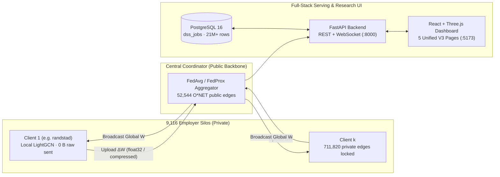
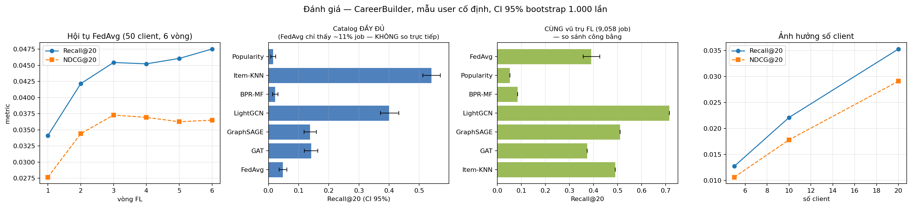
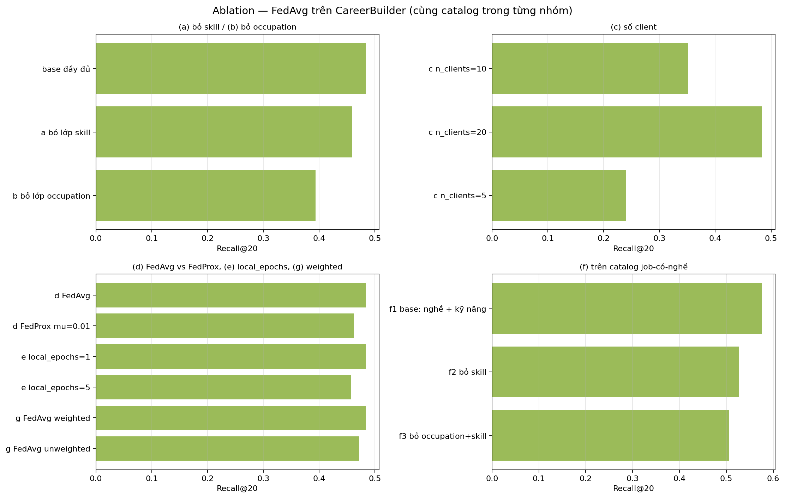

# FedGraph — GNN + Cross-Silo Federated Learning for Job Recommendation

<p align="center">
  
  
  
  <br />
  
  
  
</p>

Hệ thống gợi ý việc làm bảo vệ quyền riêng tư kết hợp **Heterogeneous Graph Neural Networks (LightGCN / GraphSAGE / GAT)** và **Cross-Silo Federated Learning (FedAvg / FedProx)** trên quy mô thực tế **CareerBuilder + O\*NET (V3)** gồm **9.116 nhà tuyển dụng (FL silos)**, **264.995 nút** và **764.364 cạnh** — đi kèm ứng dụng web full-stack **React + Three.js + FastAPI + PostgreSQL**.

---

## 1. Kiến trúc hệ thống & Ranh giới bảo mật

Trong thị trường tuyển dụng thực tế, dữ liệu ứng tuyển thuộc về từng doanh nghiệp độc lập và bị ràng buộc bởi Luật Bảo vệ Dữ liệu Cá nhân / GDPR. Hệ thống tách đồ thị thành **2 miền rõ rệt**:

- **Private Client Silos (9.116 nhà tuyển dụng):** Giữ tuyệt đối **711.820 private edges** (`436.893` `user–job` + `274.927` `user–occupation`). **0 byte raw data** rời khỏi client.
- **Public Graph Backbone (Central Server):** Chỉ giữ **52.544 public edges** (`26.678` `job–occupation` + `25.866` `occupation–skill` từ O\*NET 29.3) và tổng hợp vector cập nhật tham số **$\Delta W$** qua **FedAvg / FedProx**.



---

## 2. Quy mô dữ liệu CareerBuilder + O\*NET (V3)

| Thành phần | Quy mô thực đo (V3) | Ghi chú |
|---|---|---|
| **Tổng số nút (`graph.npz`)** | **264.995** | `171.807` Users · `84.845` Jobs · `583` O\*NET Occupations · `7.760` Tech Skills |
| **Tổng số cạnh gốc** | **764.364** | `52.544` Public Edges (Server) + `711.820` Private Edges (Client) |
| **Cross-Silo FL Clients** | **9.116 employers** | Mỗi nhà tuyển dụng $\ge 10$ applications & $\ge 2$ jobs (Top 1: `randstad`, `4.745` apps) |
| **Cross-Silo Overlap** | **44,58% users** | `76.584` ứng viên ứng tuyển đa công ty (TB `2,41` clients/user; `16,29%` same-client test) |
| **PostgreSQL (`dss_jobs`)** | **21M+ rows (9 tables)** | Gồm `2.593.468` `job_skills` & `18.017.133` `user_skills` (2-hop O\*NET inference) |
| **Train / Test Split** | **398.936 / 37.957** | `37.077` clean test edges sau khi loại `880` leakage edges & tách `1.969` cold-start jobs |

---

## 3. Kết quả thực nghiệm chính (V3)

### A. So sánh mô hình trên FL Catalog & Global Catalog

| Mô hình | Training Mode | Recall@20 (FL Catalog) | NDCG@20 (FL) | MRR@20 (FL) | Recall@20 (Global 82.876 tin) |
|---|---|---:|---:|---:|---:|
| **LightGCN** | Centralized | **0.7151** | — | — | 0.4002 |
| **FedAvg (20N · O\*NET Catalog)** | Federated (`956` tin) | **0.5756** | **0.4303** | **0.3910** | — |
| **GraphSAGE** | Centralized | 0.5113 | — | — | 0.1376 |
| **Item-KNN** | Centralized | 0.4897 | — | — | **0.5408** |
| **FedAvg (20N · Fixed FL Catalog)** | Federated (`4.511` tin) | **0.4833** | 0.3469 | 0.3150 | — |
| **FedAvg (50N · Main FL Catalog)** | Federated (`9.058` tin) | **0.3905** | 0.2615 | 0.2338 | 0.0475 |
| **Popularity** | Baseline | 0.0542 | 0.0058 | 0.0037 | 0.0154 |

### B. Ablation Study (15 variants) & Client Scaling (8 configs)

- **Public Graph Backbone (`Occupation + Skill`):** Tăng **+9.0% Recall@20** (`0.3933` khi bỏ Occupation + Skill $\rightarrow$ `0.4589` chỉ giữ Occupation $\rightarrow$ **`0.4833`** đầy đủ Occupation + Skill).
- **Client Scaling:** Mở rộng `5 nodes` (`0.2398`) $\rightarrow$ `10 nodes` (`0.3512`) $\rightarrow$ `20 nodes` (**`0.4833`**, tăng gấp **2.02×**).
- **Aggregation & Drift:** `FedAvg weighted` (`0.4833`) vs `unweighted` (`0.4716`) vs `FedProx (μ=0.01)` (`0.4627`); tăng `local_epochs` từ `1` lên `5` gây **Client Drift** (`0.4833` $\rightarrow$ `0.4565`, chậm gấp 5×).
- **Real Training Latency (300 samples, `perf_counter`):** `p50 = 418.0 ms` · `p95 = 566.6 ms`.

<p align="center">
  
  
</p>

---

## 4. Giao diện Web React + Three.js (5 trang đồng nhất V3)

Ứng dụng frontend được xây dựng bằng **React 19 + TypeScript + Vite + Tailwind CSS v4 + Three.js + Recharts + Framer Motion** theo hệ thống thiết kế **White + Signal Orange (`#FF5A1F`)** trong [`DESIGN.md`](DESIGN.md):

| # | Route | Trang | Điểm nhấn trực quan & nghiên cứu |
|---|---|---|---|
| 01 | `/` | **Tổng quan** | Mô hình 3D kiến trúc Federated GNN (Server $\leftrightarrow$ 4 Client Privacy Silos + chu kỳ 4 bước trực tiếp), Bento KPI Hero & bảng đối chứng 7 mô hình. |
| 02 | `/do-thi` | **Đồ thị việc làm** | Đồ thị tương tác `force-graph` (2D mặc định) & `3d-force-graph` (3D WebGL) trên mẫu 430 nút V3, tìm kiếm theo 4 loại nút (`Nghề O*NET`, `Kỹ năng`, `Tin`, `Ứng viên`), bật/tắt ranh giới Public vs Private & Node Inspector. |
| 03 | `/lien-bang` | **Mô phỏng FL** | Chọn 5 kịch bản V3 (`5 / 10 / 20 / 50` nodes), chuyển `FL Catalog` vs `Global Catalog`, đường cong 6 vòng, biểu đồ **Ablation Study** & **Client Scaling**. |
| 04 | `/giam-sat-node` | **Giám sát Node FL** | **FL Research Workbench** kết nối WebSocket live: 3D Topology với 2 góc nhìn (`Non-IID & Drift` vs `Latency`), tiêm lỗi Straggler (`+120ms`) / Dropout (`0–30%`) / `Deadline 65ms` / nén `ΔW` (`FP32 / FP16 / Top-20%`), **So sánh A/B chồng 2 đường**, trục `Recall@20 theo MB` và **Xuất CSV**. |
| 05 | `/ket-luan` | **Kết luận & hạn chế** | Ma trận kiểm chứng 6 tiêu chí (`5/6 Đạt`), phân tích thẳng thắn các hạn chế (O\*NET coverage `31.44%`, chưa có Online A/B Test, chưa có DP-SGD / Secure Aggregation) và roadmap cải tiến. |

---

## 5. Hướng dẫn chạy nhanh (Quick Start)

### Yêu cầu môi trường
- **Python 3.10+** (đã kiểm chứng trên `3.13.0`), **Node.js 20+** (`npm`), và **Docker** (tùy chọn cho PostgreSQL 16).

### Bước 1 — Cài phụ thuộc
```powershell
python -m pip install -r requirements.txt
python -m pip install -r api/requirements.txt
cd web && npm install && cd ..
```

### Bước 2 — Khởi chạy PostgreSQL (tùy chọn, hoặc dùng `--dry-run`)
```powershell
docker compose up -d
python -m api.load_to_pg
```
> Nếu máy không chạy Docker PostgreSQL, có thể khởi động Backend ở chế độ **in-memory** (`$env:DSS_DRY_RUN="1"`): toàn bộ REST/WebSocket vẫn hoạt động trực tiếp trên `artifacts/v3/`.

### Bước 3 — Khởi chạy Backend FastAPI (`:8000`) & Frontend React (`:5173`)
```powershell
# Terminal 1 — FastAPI Backend (tự kết nối PostgreSQL cổng 5433, fallback in-memory)
python -m uvicorn api.main:app --host 127.0.0.1 --port 8000

# Terminal 2 — React + Three.js Frontend
cd web
npm run dev
```
Mở trình duyệt tại **`http://localhost:5173`**.

### Kiểm thử tự động
```powershell
# Kiểm thử Python (API, graph integrity, regression tests)
python -m pytest tests/ -q

# Kiểm thử build production Frontend (TypeScript + Vite)
cd web && npm run build
```

---

## 6. Cấu trúc thư mục

```text
gnn-federated-job-recommendation/
├── web/                        # React 19 + TypeScript + Vite + Tailwind v4 + Three.js
│   ├── src/components/three/   # WarmSilkAurora, FederatedGlassConstellation, JobGraphExplorer3D, LiveFlTopology3D
│   ├── src/components/         # Layout (Sidebar 2D Lucide icons) & Glass/Bento UI Primitives
│   └── src/pages/              # 5 trang V3: Overview, JobGraph, FlSim, NodeMonitor, Conclusions
├── api/                        # FastAPI Backend + PostgreSQL Store + Live FL WebSocket Runner
│   ├── main.py                 # Entrypoint REST & WebSocket (/health, /api/clients, /api/train/*, /ws/*)
│   ├── dashboard.py            # 4 endpoint V3 (/api/dashboard/{overview,graph,fl-sim,conclusions})
│   ├── db.py & load_to_pg.py   # PgStore (port 5433) + InMemoryStore CSR fallback
│   └── fl_sim.py               # Asynchronous FL runner + perf_counter latency telemetry
├── src/                        # Pipeline tiền xử lý dữ liệu & mô hình GNN/FL (prepare_v3.py, models, ...)
├── notebooks/                  # Jupyter Notebooks tái lập toàn bộ thực nghiệm V3
├── results_v3/                 # Kết quả thực nghiệm V3 (notebook_metrics.json, CSV & 6 hình 400dpi)
├── app/ & ui/                  # Phiên bản Streamlit legacy & standalone FL Node Console
├── tests/                      # Bộ regression tests (pytest)
├── DESIGN.md                   # Đặc tả hệ thống thiết kế White + Signal Orange
└── docker-compose.yml          # Container PostgreSQL 16 (dss-postgres:5433)
```

---

## 7. Hạn chế & Hướng phát triển

1. **O\*NET Occupation Coverage (`31.44%`):** Áp dụng Sentence-BERT / embedding similarity để nâng ánh xạ `job–occupation` lên `>85%` trên toàn bộ `84.845` tin.
2. **Global Catalog Gap (`0.0475` vs `0.4002`):** Áp dụng *Stratified Client Sampling* qua nhiều vòng hơn trên `9.116` silo.
3. **Cryptographic Privacy:** Bổ sung **Secure Aggregation** và **Differential Privacy (DP-SGD)** để bảo vệ vector $\Delta W$ trước tấn công suy ngược gradient.
4. **Online Evaluation:** Triển khai **Online A/B Test** đo trực tiếp CTR và mức độ hài lòng của ứng viên.
